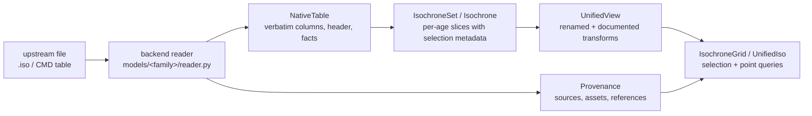

# Architecture

stellariso is organized around one rule: **native data first, unified access
on top, provenance everywhere**. This page describes the two data layers and
the objects that carry them.

## The native layer

`NativeTable` (`stellariso.native`) holds exactly what the file says:

- the data rows as an `astropy.table.Table`, columns in file order under the
  file's own names;
- the verbatim comment/header lines;
- structured facts the backend extracted from the header (values as stated,
  never inferred);
- per-isochrone block metadata (stated row counts, per-block composition).

Nothing is renamed, converted, re-typed, or filled in at this layer.

## The unified layer

`UnifiedView` (`stellariso.unified`) maps native columns to canonical field
names through `FieldSpec`s (`stellariso.core`):

- `origin=native` — the same numbers under a canonical name
  (`current_mass` ← MIST `star_mass`, PARSEC `M_act`);
- `origin=transformed_native` — a documented transformation from a fixed,
  named vocabulary (currently `10 ** x`), e.g. `radius` ← `log_R`;
- `origin=derived` — computed from native data, currently only the coarse
  evolutionary stage via a versioned `PhaseMapping` (unmapped codes resolve
  to `unknown` with a warning, never to a guess).

Every unified field is traceable: `iso.field_info(name)` returns the spec
stating the native column, units, representation, transformation, backend,
and mapping version. `to_table()` materializes the unified layer with units
and embedded mapping metadata.

## Parameters

`ParameterSpec` (`stellariso.core`) records each physical parameter with a
role:

| role | meaning | example |
|---|---|---|
| `axis` | varies across the published grid; the product pins a value in selection metadata | `log_age`, `initial_feh` (MIST), `initial_z` (PARSEC) |
| `fixed` | held at a known value for this product | `alpha_fe = 0.0` |
| `derived` | determined by other parameters through a stated relation | `initial_helium = Y_p + dYdZ·Z` (PARSEC) |
| `implicit` | necessarily used by the model, not recoverable from the data | `mixing_length` |
| `not_applicable` | does not exist under this product's physics | `initial_rotation` for PARSEC v1.2S |

"Value" notions stay separate: available axis values, fixed values, and the
grid-selection pins live in different places and never masquerade as each
other.

## Provenance

`Provenance` (`stellariso.provenance`) separates:

- `data_sources` — `SourceRecord`s classified by channel (official origin,
  scientific archive, third-party package, local user file, ...);
- `assets` — `DataAsset`s with checksums and retrieval timestamps;
- `source_chains` — upstream → immediate → transformations;
- `scientific_references` / `software_references` — what to cite, kept apart
  from download URLs.

The data cache (`stellariso.retrieval`) doubles as the offline backup:
checksum-matching files are never re-fetched, and every asset is recorded in
a JSON registry.

## Selection and interpolation

`IsochroneGrid.get_isochrone` supports `exact` (loud
`GridPointNotFoundError`) and `nearest` (warns, and records requested vs
returned values and distances in `selection_info`). Selectable coordinates
are derived from what each backend pins (MIST: `log_age`, `initial_feh`,
`alpha_fe`, `initial_rotation`; PARSEC: `log_age`, `initial_z`).

Within one isochrone, `interpolate_along` interpolates along a monotonic
coordinate (`initial_mass` by default) with `linear` or `pchip`; requests
outside the range raise, non-monotonic coordinates raise, and every result
carries an `InterpolationRecord` with the bracketing nodes and their native
phases. **Cross-isochrone interpolation (age, composition) is deliberately
not provided**: without a verified alignment coordinate it can connect the
wrong evolutionary stages.

## Backends

A backend (see `stellariso/models/`) contributes:

1. a cheap `recognize` sniffer,
2. a literal `reader` producing `NativeTable` + facts + blocks,
3. product knowledge: `ModelIdentity`, `ParameterSpec`s, field and phase
   mappings,
4. (optionally) fetch channels for `stellariso.retrieval`.

Core code dispatches through the registry (`stellariso.models.get_backend`);
there are no model-name branches outside the backends. Adding a model family
means adding a package under `models/` and registering it — the grid, unified
view, selection, interpolation, and facade machinery are model-agnostic.

## Versioning

Four versions coexist and never collapse into one: the stellariso package
version (`stellariso.__version__`), the unified schema version, per-backend
field-mapping versions (`FieldSpec.mapping_version`), and the upstream model
release (`ModelIdentity.release`).
