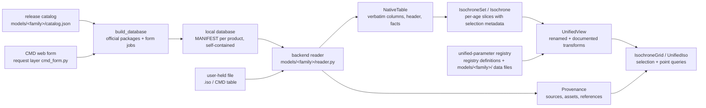

# Architecture

stellariso is organized around one rule: **native data first, unified access
on top, provenance everywhere**. This page describes the two data layers and
the objects that carry them.

## The native layer

`NativeTable` (`stellariso.native`) holds exactly what the file says:

- the data rows as an `astropy.table.Table`, columns in file order under the
  file's own names;
- the verbatim comment/header lines;
- structured facts the backend extracted from the header (values as stated,
  never inferred);
- per-isochrone block metadata (stated row counts, per-block composition).

Nothing is renamed, converted, re-typed, or filled in at this layer.

## The unified layer

`UnifiedView` (`stellariso.unified`) maps native columns to canonical field
names through `FieldSpec`s (`stellariso.core`):

- `origin=native` — the same numbers under a canonical name
  (`current_mass` ← MIST `star_mass`, PARSEC `M_act`);
- `origin=transformed_native` — a documented transformation from a fixed,
  named vocabulary (currently `10 ** x`), e.g. `radius` ← `log_R`;
- `origin=derived` — computed from native data, currently only the coarse
  evolutionary stage via a versioned `PhaseMapping` (unmapped codes resolve
  to `unknown` with a warning, never to a guess).

Every unified field is traceable: `iso.field_info(name)` returns the spec
stating the native column, units, representation, transformation, backend,
and mapping version. `to_table()` materializes the unified layer with units
and embedded mapping metadata.

## The unified-parameter registry

The registry is split by ownership, and none of it lives in Python code.
`src/stellariso/registry/unified_parameters.json` holds stellariso's own
definitions — allowed unified fields, coarse stages, and the physical
parameters a product can carry. Each model family's characteristics and
its mapping into that vocabulary (field/phase mappings, static parameter
knowledge, literature references) live in the family's data file
`src/stellariso/models/<family>/unified_parameters.json`, next to its
`catalog.json`. `stellariso.registry` loads the definitions and every
family file together and validates the merged registry (unknown unified
names, non-standard stages, and unimplemented transformations are
rejected at load). Values that only the data files know (a file's
[Fe/H], its age list) are injected at read time through
`resolve_parameters(backend, dynamic)`; variants such as PARSEC's
initial_z present/absent or the conditional eta_reimers are declared in
the family file, not coded as branches.

The human-readable reference
[docs/unified-parameters.md](unified-parameters.md) is generated from the
registry by `tools/generate_parameter_docs.py`; a test keeps the two in
sync. Built databases carry a snapshot of the same document.

## The local database

`stellariso.database` replaces any notion of a cache. A database is one
directory the user chooses and passes explicitly (`database=...`); there is
no environment variable and no implicit fallback location.

- `build_database(database=...)` acquires, once, the complete published
  matrix declared in per-family release catalogs
  (`models/<family>/catalog.json`). Package products are downloaded,
  kept as the official archives (the database doubles as the offline
  backup), extracted, and described by a per-product `MANIFEST.json` —
  source URL, sha256, size, retrieval time, file format, citations.
  Form products (PARSEC) submit their declared payload through the
  request-layer client `models/parsec/cmd_form.py`, verify the server's
  header echo, and archive the table with its complete acquisition
  record (exact payload, timestamps, checksum) under the
  `official_computed` source class. Verified products are never
  re-acquired, whichever the channel — a form job is server-side
  compute.
- `open_database(database=...)` / `Database.grid("mist/1.2", label=...)`
  query the database fully offline.
- Self-containment: the root carries `database.json` (inventory),
  `README.md` (summary with format notes and citations), and a
  `unified-parameters.md` snapshot, so the data stays interpretable with
  the upstream websites gone.
- Portability: manifests store relative paths only; the whole database or
  any subset of its product directories can be copied to another machine
  and opened there.

A family whose catalog declares no usable channel makes `build_database`
fail loudly with the manual registration procedure (no current family
does); `register_local_product` records locally held files with the same
manifest shape and an explicit `local_user_file` source class.

## Parameters

`ParameterSpec` (`stellariso.core`) records each physical parameter with a
role:

| role | meaning | example |
|---|---|---|
| `axis` | varies across the published grid; the product pins a value in selection metadata | `log_age`, `initial_feh` (MIST), `initial_z` (PARSEC) |
| `fixed` | held at a known value for this product | `alpha_fe = 0.0` |
| `derived` | determined by other parameters through a stated relation | `initial_helium = Y_p + dYdZ·Z` (PARSEC) |
| `implicit` | necessarily used by the model, not recoverable from the data | `mixing_length` |
| `not_applicable` | does not exist under this product's physics | `initial_rotation` for PARSEC v1.2S |

"Value" notions stay separate: available axis values, fixed values, and the
grid-selection pins live in different places and never masquerade as each
other.

## Provenance

`Provenance` (`stellariso.provenance`) separates:

- `data_sources` — `SourceRecord`s classified by channel (official origin,
  scientific archive, third-party package, local user file, ...);
- `assets` — `DataAsset`s with checksums and retrieval timestamps;
- `source_chains` — upstream → immediate → transformations;
- `scientific_references` / `software_references` — what to cite, kept apart
  from download URLs.

Acquisition provenance for a database product is read from its MANIFEST
(`Database.provenance`); CMD form tables additionally archive the exact
ordered request payload and the server's own header echo in their
acquisition records.

## Selection and interpolation

`IsochroneGrid.get_isochrone` supports `exact` (loud
`GridPointNotFoundError`) and `nearest` (warns, and records requested vs
returned values and distances in `selection_info`). Selectable coordinates
are derived from what each backend pins (MIST: `log_age`, `initial_feh`,
`alpha_fe`, `initial_rotation`; PARSEC: `log_age`, `initial_z`).

Within one isochrone, `interpolate_along` interpolates along a monotonic
coordinate (`initial_mass` by default) with `linear` or `pchip`; requests
outside the range raise, non-monotonic coordinates raise, and every result
carries an `InterpolationRecord` with the bracketing nodes and their native
phases. **Cross-isochrone interpolation (age, composition) is deliberately
not provided**: without a verified alignment coordinate it can connect the
wrong evolutionary stages.

## Backends

A backend (see `stellariso/models/`) contributes:

1. a cheap `recognize` sniffer,
2. a literal `reader` producing `NativeTable` + facts + blocks
   (version-anchored where the source's formats differ across versions:
   the PARSEC reader dispatches on the file's own CMD version echo),
3. product knowledge: `ModelIdentity` and the reader-side value injection
   into the registry's parameter templates,
4. a release `catalog` (`models/<family>/catalog.json`) declaring every
   product the database builder acquires — official packages (URL,
   filename, size) or form-computed products (the exact payload of the
   log-age half of each blueprint cell, the header echo to verify where
   the output carries one; the linear young-age half is archived beside
   the log table by the blueprint builder); request layers that speak a
   service's wire protocol (the CMD form client) sit beside the backend.

Core code dispatches through the registry (`stellariso.models.get_backend`);
there are no model-name branches outside the backends. Adding a model family
means adding a package under `models/` and registering it — the grid, unified
view, selection, interpolation, database, and facade machinery are
model-agnostic.

## Versioning

Five versions coexist and never collapse into one: the stellariso package
version (`stellariso.__version__`), the unified-registry schema version,
per-backend field-mapping versions (`FieldSpec.mapping_version`), the
release-catalog contents (each product records its source URL and checksum
in its MANIFEST), and the upstream model release (`ModelIdentity.release`,
which every version-qualified model spec is validated against).
