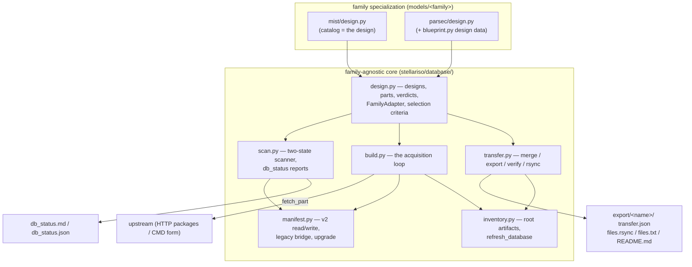

# Database management

A stellariso database is one directory the user chooses and passes explicitly (`database=...`): no environment variable, no implicit location, no cache semantics. Built once by `build_database`, queried fully offline by `open_database`. Every product directory is self-contained (data files + acquisition records + a v2 MANIFEST, relative paths only), so the whole database — or any subset of its product directories — copies to another machine and opens there.

This page expands the whole management machinery: the concepts, the two-state model, the MANIFEST schema, and every operation (build, status, refresh, merge, export, verify, upgrade). The PARSEC family's own design data is expanded in [parsec/blueprint.md](parsec/blueprint.md); the MIST release catalog lives at `models/mist/catalog.json`.



## Concepts

Seven concepts; the first four are data, the last three are operations:

| Concept | Definition | Unit role |
|---|---|---|
| **Product** | one directory `<family>/<collection>/<label>/`, self-contained | storage, identity, merge, and export unit |
| **Part** | one acquisition unit inside a product (an archive, or one form table) with its optional record | fetch, verify, and verdict unit |
| **Design** | a source's declared complete target: every product that should exist × its designed parts | the authority the database is measured against |
| **Family adapter** | one source's implementation of the generic protocol (enumerate designs, map a directory, judge a part, fetch a part) | the only family-specific code |
| **Scanner** | classifies every product part by part against the design, two states out | read-only, pure local I/O |
| **Builder** | fetches each missing part of each clean committed product, through the adapter | the only write path into a database |
| **Transfer** | merge (database ← database), export (selection → plan), verify, transport | moves products between machines |

`<collection>` is the directory second level: the release for package families (MIST `1.2`), the set key for form families (PARSEC `v1.2S_COLIBRI_web`). The manifest identity triple is `(family, release, label)`; for PARSEC the release string is the model-spec release, distinct from the set key.

## The two-state model

A product is **complete** exactly when every designed part is `ok`; otherwise it is **incomplete**. The finer outcomes live in per-part verdicts, never in product-level status names:

| Part verdict | meaning |
|---|---|
| `ok` | present and conforming (may carry non-blocking warnings — an intact MIST archive whose size deviates from the catalog) |
| `missing` | nothing archived for the part |
| `nonconforming` | data present but off-design — sha mismatch against the recorded checksum, a payload that is not the designed submission, a wrong isochrone count, an unreadable acquisition record |

Remaining work is reported in two deliberately separate lists: **missing parts of clean products** are the builder's automatic plan; **products needing review** (any nonconforming part, or a directory at a designed path that maps elsewhere) are never auto-completed — whether such data is re-fetched is a human decision, so the report lists them with reasons instead of folding them into the automatic count.

## Invariants

1. Archived data is never overwritten and never deleted; the builder and the merger only add what is missing.
2. A product holding any nonconforming part is never auto-completed, on either side of a merge — a checksum proves integrity, not design membership.
3. A conflicting part (both sides archived, shas disagree) is never resolved automatically; both values are recorded and a human decides.
4. Root-level derived artifacts (`database.json`, `README.md`, the `unified-parameters.md` snapshot, `db_status.*`) are regenerated from the product directories, never copied between machines and never merged.
5. No cross-product mutable state: every operation proceeds product by product, order-independent.

## The MANIFEST

Every product directory carries one `MANIFEST.json` in schema `stellariso-manifest/2`:

```json
{
  "schema": "stellariso-manifest/2",
  "family": "parsec",
  "release": "v1.2S +  COLIBRI S_37 + S_35 + PR16",
  "label": "mh_p0.0",
  "kind": "cmd_form_isochrones",
  "source_class": "official_computed",
  "note": "...",
  "format": "cmd_table_3_9",
  "references": ["..."],
  "parts": {
    "log":    {"file": "output.dat", "sha256": "...", "size_bytes": 1,
               "n_data_rows": 177, "retrieved_at": "...",
               "record": "output.dat.record.json", "url": "..."},
    "linear": {"file": "output_linear.dat", "sha256": "...", "size_bytes": 1,
               "n_data_rows": 40, "retrieved_at": "...",
               "record": "output_linear.dat.record.json", "url": "..."}
  },
  "family_section": {"module": "...", "set": "...", "axes": {"...": "..."},
                     "age_grids": {"...": "..."}}
}
```

- `parts` maps each designed part to its archive facts. Package products have a single `archive` part; form products have `log` and `linear` parts. A manually registered product's parts are its files, checksummed at registration.
- `family_section` carries the family's own design pin (PARSEC: the blueprint cell identity — axes and age grids); it is absent when the family has none (MIST).
- Package products additionally carry `extracted` / `n_data_files` — **local materialization state, not parts**: the archive is the acquired unit, always kept beside any extraction (it is the true original data), and extraction on demand never affects completeness. Archives-only databases (`build_database(..., extract=False)`) are fully supported; `Database.grid` extracts on first open, verifying the archive's recorded sha256 first.

**Reading is version-tolerant, writing is not.** The read side (`stellariso.database.manifest`) accepts the historical shapes too — the run-4 package product (flat top-level `sha256` describing the archive), the run-4 form product (the same flat keys describing the log table), and the blueprint form product (a `blueprint` section whose `parts` map supersedes the flat keys) — and returns a v2-shaped view, so old database copies and backups open without any prior conversion. Every write path goes through one function that stamps the current schema; no code can persist a legacy shape.

**Upgrading a whole database.** `tools/db_transfer.py migrate-manifests <db>` (dry run by default, `--apply` to write) rewrites every product MANIFEST to clean v2 in one pass: one atomic rewrite per product, archived data files untouched. A manifest whose information cannot be carried over losslessly — an unknown schema from a newer stellariso, a missing identity, flat keys contradicting the blueprint parts — is reported with its reasons and left exactly as it was; the read bridge keeps it usable, and the disposition stays with the database owner.

## Operations

### Build

```python
db = stellariso.build_database("path/to/database")          # complete what is missing
stellariso.build_database("path/to/database", dry_run=True) # the plan, nothing written
```

One loop serves every family. It scans first, then per product: needs-review products are skipped with a NOTICE; every missing part of a clean product is fetched through its family adapter (an archive download, or one form submission with a polite pause between submissions); the MANIFEST is rewritten as clean v2 (kept parts carry over untouched). Verified parts are never re-acquired — a form job is server-side compute, and a re-run only completes what is missing. `models=` limits the build to given families; `session=` supplies the HTTP session; `verify_existing=False` classifies present files without re-hashing (the rebuild-trust knob); `extract=False` keeps only the official archives.

### Status

```bash
python tools/db_status.py C:/path/to/database
```

Writes `db_status.md` + `db_status.json` at the database root and prints the digest: per family the source's own declarations (axes, grids, windows), one line per product — `complete`, or `incomplete` with the per-part detail and reasons — plus the superseded directories (present but mapping nowhere in the design, with reasons), the automatic-fetch plan, and the manual-review list. A database root that still carries `blueprint_status.*` reports from earlier tooling keeps them; `db_status.*` is the report that is regenerated, and an old report's per-cell statuses read against it as: complete → complete; log-only → incomplete (log ok, linear missing); re-fetch → incomplete with a nonconforming part, manual review; pending → incomplete, all parts missing. The library face is `stellariso.database.scan.scan_database`; its `DatabaseReport` carries per-product verdicts for programmatic use.

### Refresh

```python
stellariso.refresh_database("path/to/database")
```

Regenerates every derived root artifact from the product directories: `database.json` (the inventory), `README.md` (the human summary with format notes and citations), the `unified-parameters.md` snapshot, and `db_status.*`. The receiving end of any transfer runs this once after data lands; a database is openable without it (a partial copy is a legal database), the refresh only restores the derived view.

### Export

```python
from stellariso.database.design import SelectionCriteria
from stellariso.database.transfer import export_database

result = export_database(db, SelectionCriteria(families=("parsec",),
                                                axes={"mh": (-1.0, 0.0)}),
                         name="metal-poor")
```

```bash
python tools/db_transfer.py export <db> --name metal-poor --families parsec --mh "-1.0:0.0"
```

Writes `<db>/export/<name>/` (the plan travels with the database, so rsync from the database root carries it along):

| file | content |
|---|---|
| `transfer.json` | the machine-readable plan: selection, per-product entries (identity, kind, axes, state, every file with path/size/sha256), totals |
| `files.rsync` | the `rsync -a --files-from` path table: product directories plus the plan itself |
| `files.txt` | the same expanded to file level (for copy / robocopy / manual checks) |
| `README.md` | the receiving procedure |

Every file of every selected product is listed — archives, form tables, records, and **extracted content alike**: extraction is local materialization state and never a selection or completeness condition. Shas come from the MANIFESTs as recorded; `--checksums all` additionally hashes the unrecorded files (the extracted content), making the plan end-to-end verifiable at the cost of reading every selected byte.

Selection is declarative: `families`, `collections`, `labels`, `products` (explicit `family/collection/label` paths), `states` (default `complete`; `complete,incomplete` seeds a second build machine), `target_only` (restrict to the current fetch stage), and family axis filters (`mh` windows or lists, `omega`, `eta`, `n_inTPC`, `dust_m`, `dust_c`, `lpv`, `tier` for PARSEC) interpreted by the family adapter. No filter means the whole database.

### Transport

- **rsync**: `python tools/db_transfer.py rsync <db> --name N --destination user@host:/path/db/` assembles the command (`rsync -a --info=progress2 --files-from=<plan>/files.rsync <db>/ dest`); `--exec` runs it. rsync is assembled, not reimplemented; without rsync on PATH the tool says so (on Windows: WSL or cwRsync).
- **copy channel**: `merge_database` below — pure shutil with checksum verification, cross-platform.

### Merge

```python
stellariso.merge_database("subset-or-full-source", "path/to/target")
```

```bash
python tools/db_transfer.py merge <source> <target>          # same selection flags
```

Imports one local database — or any partial copy of one; an rsync'd subset is itself a legal database — into another, keyed by directory relative path with the manifest identity triple cross-checked:

| source | target | action |
|---|---|---|
| product, all parts sound | directory absent | staged whole-directory copy, per-part sha verified, atomic placement |
| product, mixed (some nonconforming) | directory absent | built from its sound parts only; disowned data never propagates |
| sound part | same product, that part missing | part-level completion: file + record copied, sha verified, parts union written as v2 |
| overlapping part, shas equal | present | kept, nothing written |
| overlapping part, shas differ | — | conflict: both shas recorded, the target is not touched |
| product needing review | anything | not merged (source side) / left untouched (target side) |
| superseded source directory | — | not merged, listed |

Staging lives under `<target>/.staging/` (swept at start and at exit); after the merge the target's derived root artifacts are regenerated. The report (`MergeReport`) itemizes every outcome.

### Verify

```bash
python tools/db_transfer.py verify <db> --plan <db>/export/<name>/transfer.json
```

Recomputes every recorded checksum and size against the receiving database and reports missing files, size mismatches, and sha mismatches. Files without a recorded sha (extracted content exported without `--checksums all`) are checked for presence and size.

## Adding a family

A family implements one `FamilyAdapter` (`stellariso.database.design`) and thereby gains the whole stack — scanning, building, dry-run planning, status reports, merge, export, verify, inventory:

| capability | the adapter provides | the core provides |
|---|---|---|
| product/part model | its parts (`archive`, or `log`/`linear`, or its own) | the design types and verdicts |
| design enumeration | `designs()` / `committed()` (a staged source narrows the second) | iteration, caching, ordering |
| directory → design mapping | `product_of_directory()` (payload authority, name fallback) | the walk, duplicate and superseded bookkeeping |
| part judgment | `classify_part()` | the two-state rollup, review separation |
| part acquisition | `fetch_part()` (+ a session/client hook) | the loop, pausing, MANIFEST v2 writes, extraction |
| manifest extras | `family_section()`, `manifest_fields()` | schema, parts merge, identity |
| reporting | `report_header()` (its own declarations) | rendering, markdown/json |

## Tools

| command | purpose |
|---|---|
| `python tools/db_status.py <db>` | two-state status report for every family (`db_status.md`/`.json`) |
| `python tools/db_transfer.py export <db> [selection]` | write an export plan under `<db>/export/<name>/` |
| `python tools/db_transfer.py rsync <db> --name N --destination D [--exec]` | assemble (or run) the rsync transport |
| `python tools/db_transfer.py merge <source> <target> [selection]` | import through the copy channel |
| `python tools/db_transfer.py verify <db> --plan P` | check a database against a plan |
| `python tools/db_transfer.py refresh <db>` | regenerate the derived root artifacts |
| `python tools/db_transfer.py migrate-manifests <db> [--apply]` | rewrite every MANIFEST to clean v2 |
